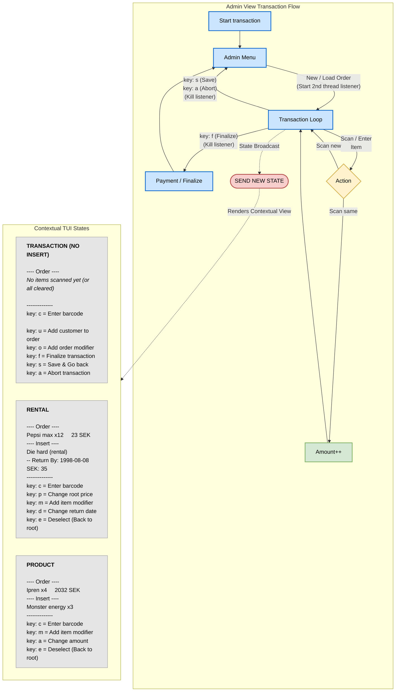

## Order flow

From the admin terminal, the cashier can choose "Start transaction".

## Transaction view

This view is presented when the cashier chooses "Enter transaction" from the main menu.  
If there are no transactions, a new one is automatically created.  
If there exists unfinished transactions, the cashier will be presented ongoing transactions in a date-ordered list.  
The cashier can select a transaction using its ID, or create a new one by pressing n.

When the transaction state is active, the program activates the scanner thread and listens asynchronously for
updates via the Virtual COM port. The cashier now has 2 interfaces to interact with items:

- The scanner, which can add or remove items.
- The TUI, which has full control over the transaction.

When the transaction is finalized (Cashier presses F and a payment is made),
the transaction is added to the order table.

Note: Any transaction containing a rental item or service (such as "Åverkansvite" or "Förseningsavgift")
must have a customer bound to the order. The cashier will be prompted about this when entering the finalize stage, if no customer is already added.

