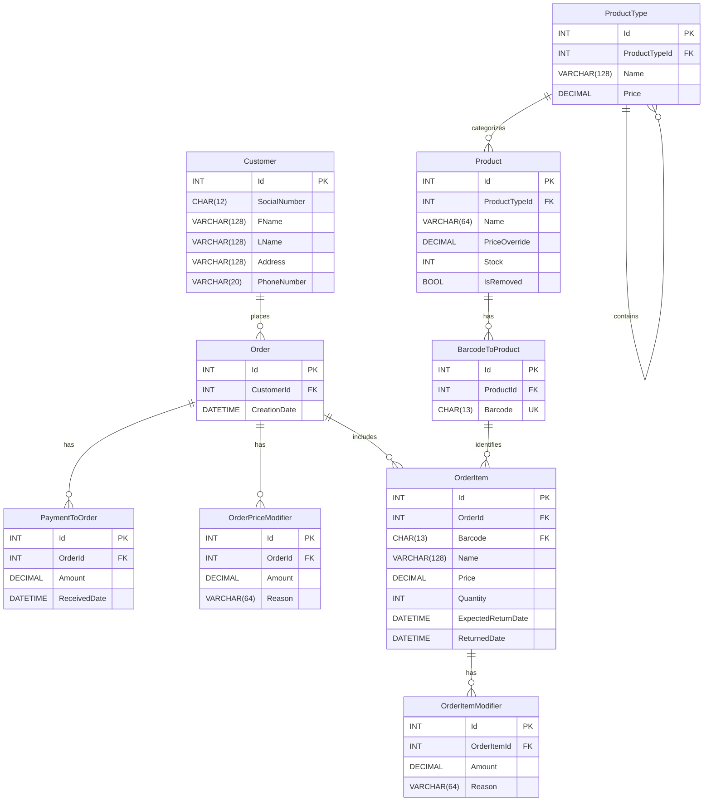
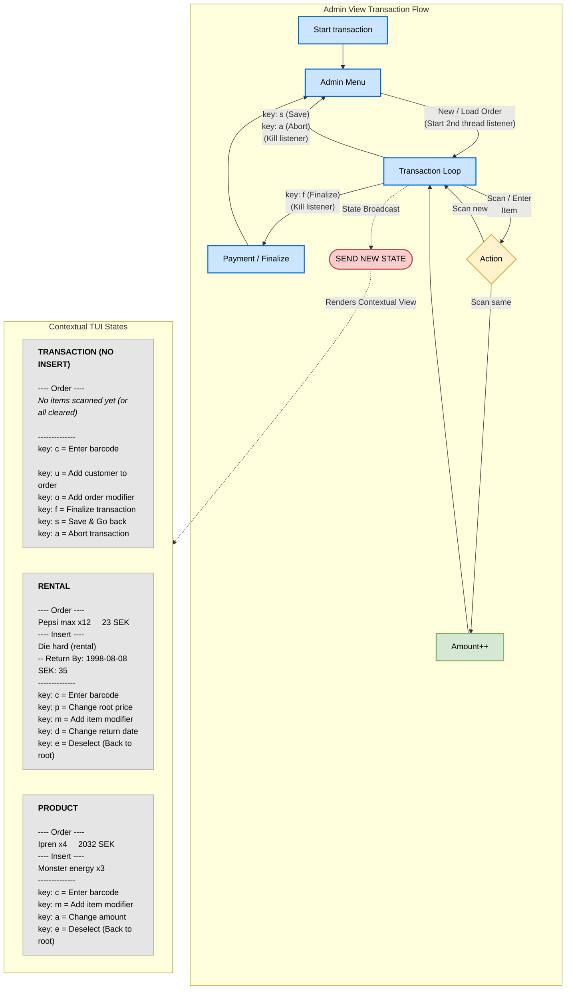

# Utemorgon 🎬🍿

A 3 student school project utilizing MariaDB, Dapper and C# to create a Terminal based Point of Sale system.

## The environment variables

In order to connect to the database, we need an Ip, port, username and password.  
These must be placed in a `.env` file at the root of the project.  
The `.env` file must contain exactly 1 key-value-pair per row, and split them using an equals sign.  
There is no need for citations `"` to define strings.

To fetch env variables in code, use the `EasyEnv` wrapper:

```csharp
int port = EasyEnv.Get<int>("port"); // Case insensitive.
```

## Program flow

TODO: Expand this to provide some actual usable information
From the admin terminal, the cashier can choose "Start transaction".

## Diagrams and designs 📊

### Database

A note on **denomarlization**:  
We are purposefully not introducing denormalization, even though it would make sense in a large scale application.
This is to keep the normalization somewhat pure and academic for learning purposes, but also to decrease scope and possible point of failures.

_Where denormalization **could** be applied_:

- TotalPrice & TotalPayed in **Order**
- MerchandiseType in Product
  This would remove the implicit flow of `stock = null AND ProductType = 'Rental'` / `stock = null AND ProductType = 'Service'`

#### Entity relations diagram



#### Arrow diagram

_Note: Mermaid doesn't allow for neat diagrams. Instead see the arrow diagram on the designated arrow-diagram tool: [SQL Visualizer](https://trangius.se/sql_visualizer/)._

Open the link and post the following:

```js
# Utemorgon videorek.

# All Customer data is 2-way Encrypted with a key.
Customer
  Id
  SocialNumber char(12) unique
  FName
  LName
  Address
  PhoneNumber vc(20)

# Id used to create rental barcodes by accessing sequence (?) and inserting: "R0000..ID"
BarcodeToProduct
  Id
  ProductId -> Product.Id
  Barcode char(13) unique

# Filtering
ProductType
  Id
  ProductTypeId null -> ProductType.Id
  Name
  Price decimal(10,2)

# Soft removal using bool so that legacy META will never be tainted.
# When stuck is nul, the product is implicitly a rental product.
# Services, such as "Late Fee" or "Ruined Property" also have stock as null, however, they are of product type "Services", meaning rental movies must filter out that type to be accurate.
Product
  Id
  ProductTypeId -> ProductType.Id
  Name vc(64)
  PriceOverride decimal(10,2) null
  Stock int null
  IsRemoved bool


# Orders are always paid in full at the register.
Order
  Id
  CustomerId -> Customer.Id
  CreationDate datetime

PaymentToOrder
  Id
  OrderId -> Order.Id
  Amount decimal(10,2)
  ReceivedDate datetime

# (Replaces rented product and BoughtProduct)
OrderItem
  Id
  # Customer ID moves to order...
  OrderId -> Order.Id
  Barcode -> BarcodeToProduct.Barcode
  # -- Receipt onligatiods
  Name vc(128)
  Price decimal(10,2)
  Quantity int
  # -- Rental meta (null if IsRental is false)
  ExpectedReturnDate datetime null
  ReturnedDate datetime null
  unique(OrderId, Barcode)

# Individual discount per item, eg: Ät snart, 3 för 2, sötnosrabatt osv..
OrderItemModifier
  Id
  OrderItemId -> OrderItem.Id
  Amount decimal(10,2)
  Reason vc(64)

OrderPriceModifier
  Id
  OrderId -> Order.Id
  Amount decimal(10,2)
  Reason vc(64)
```

### Transaction view

This view is presented when the cashier chooses "Enter transaction" from the main menu.  
If there are no transactions, a new one is automatically created.  
If there exists unfinished transactions, the cashier will be presented ongoing transactions in a date-ordered list.  
The cashier can select a transaction using its ID, or create a new one by pressing n.

When the transaction state is active, the program activates the scanner thread and listens asynchronously for
updates via the Virtual COM port. The cashier now has 2 interfaces to interact with items:

- The scanner, which can add or remove items.
- The TUI, which has full control over the transaction.

When the transaction is finalized (Cashier presses F and a payment is made),
the transaction is added to the order table.

Note: Any transaction containing a rental item or service (such as "Åverkansvite" or "Förseningsavgift")
must have a customer bound to the order. The cashier will be prompted about this when entering the finalize stage, if no customer is already added.



**If the transaction diagram does not load, paste the following in any program that accepts mermaid codeblocks:**

```
flowchart TD
    %% Define styling classes to match the vibe
    classDef blueBox fill:#cce5ff,stroke:#0066cc,stroke-width:2px,color:#000;
    classDef yellowDiamond fill:#fff2cc,stroke:#d6b656,stroke-width:2px,color:#000;
    classDef greenBox fill:#d5e8d4,stroke:#82b366,stroke-width:2px,color:#000;
    classDef redOval fill:#f8cecc,stroke:#b85450,stroke-width:2px,color:#000;
    classDef mockupBox fill:#e5e5e5,stroke:#999,stroke-width:1px,color:#000;

    %% Main Application Flow
    subgraph Flow [Admin View Transaction Flow]
        direction LR
        Start[Start transaction]:::blueBox --> Menu[Admin Menu]:::blueBox

        Menu -- "New / Load Order<br>(Start 2nd thread listener)" --> ScanMenu[Transaction Loop]:::blueBox
        ScanMenu -- "key: s (Save)<br>key: a (Abort)<br>(Kill listener)" --> Menu
        ScanMenu -- "key: f (Finalize)<br>(Kill listener)" --> Checkout[Payment / Finalize]:::blueBox
        Checkout --> Menu

        ScanMenu -- "Scan / Enter<br>Item" --> Action{Action}:::yellowDiamond

        Action -- "Scan same" --> AmountPlus[Amount++]:::greenBox
        AmountPlus --> ScanMenu

        Action -- "Scan new" --> ScanMenu

        %% Sending state is a broadcast triggered by the Scan Menu updates
        ScanMenu -. "State Broadcast" .-> SendState([SEND NEW STATE]):::redOval
    end

    %% Contextual UI Mockups
    subgraph UI [Contextual TUI States]
        direction LR
        RootView["<div style='text-align:left;'><b>TRANSACTION (NO INSERT)</b><br><br>---- Order ----<br><i>No items scanned yet (or all cleared)</i><br><br>--------------<br>key: c = Enter barcode<br><br>key: u = Add customer to order<br>key: o = Add order modifier<br>key: f = Finalize transaction<br>key: s = Save & Go back<br>key: a = Abort transaction</div>"]:::mockupBox

        Rental["<div style='text-align:left;'><b>RENTAL</b><br><br>---- Order ----<br>Pepsi max x12 &nbsp;&nbsp;&nbsp;&nbsp;23 SEK<br>---- Insert ----<br>Die hard (rental)<br>-- Return By: 1998-08-08<br>SEK: 35<br>--------------<br>key: c = Enter barcode<br>key: p = Change root price<br>key: m = Add item modifier<br>key: d = Change return date<br>key: e = Deselect (Back to root)</div>"]:::mockupBox

        Product["<div style='text-align:left;'><b>PRODUCT</b><br><br>---- Order ----<br>Ipren x4 &nbsp;&nbsp;&nbsp;&nbsp;2032 SEK<br>---- Insert ----<br>Monster energy x3<br>--------------<br>key: c = Enter barcode<br>key: m = Add item modifier<br>key: a = Change amount<br>key: e = Deselect (Back to root)</div>"]:::mockupBox

    end

    %% Connect the state broadcast to the UI updates
    SendState -. "Renders Contextual View" .-> UI
```
