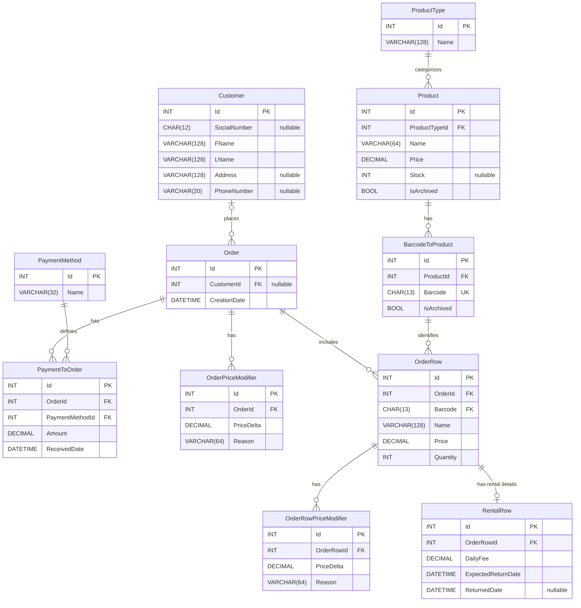
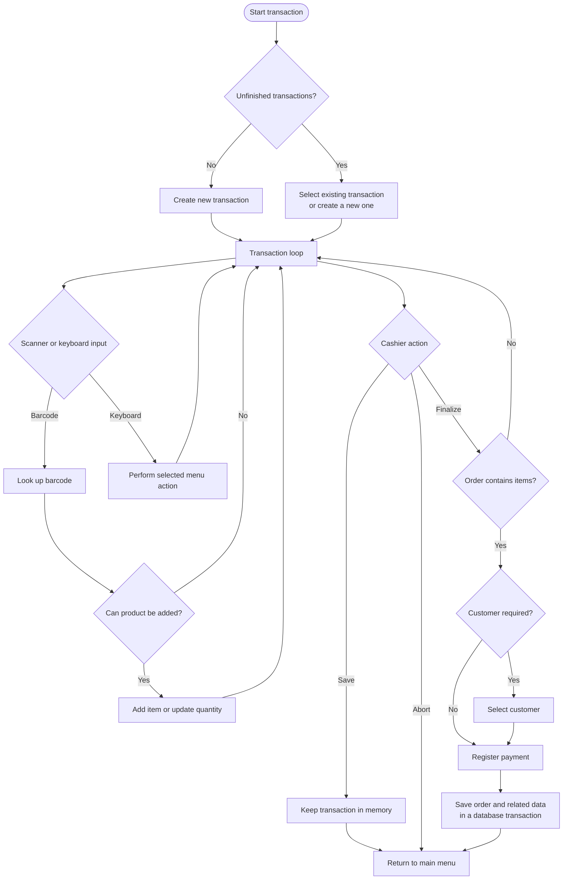
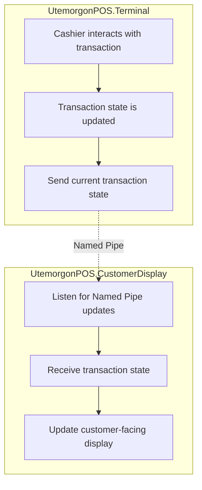

# Utemorgon 🎬🍿

A 4 student school project utilizing MariaDB, Dapper and C# to create a terminal-based Point of Sale system.

## The environment variables

In order to connect to the database, we need an IP, port, username and password.

These must be placed in a `.env` file at the root of the project.

The `.env` file must contain exactly one key-value pair per row, split using an equals sign. There is no need for quotation marks (`"`) to define strings.

To fetch environment variables in code, use the `EasyEnv` wrapper:

```csharp
int port = EasyEnv.Get<int>("port"); // Case insensitive.
```

The barcode scanner also requires a configured serial port. This is specified using the `ScannerPort` environment variable.

## Program flow

The application is operated through the admin terminal, where the cashier can access the different parts of the system.

From the main menu, the cashier can:

- Enter a transaction.
- Manage customers.
- Manage products.
- Return rental products.
- Exit the application.

### Transaction view

This view is presented when the cashier chooses "Enter transaction" from the main menu.

If there are no unfinished transactions, a new one is automatically created. If unfinished transactions exist, the cashier is presented with a date-ordered list and can select an existing transaction or create a new one.

Transactions that are saved and left unfinished are kept in memory for the duration of the application session.

When a transaction is active, the cashier has two interfaces to interact with items:

- The barcode scanner, which can add products to the transaction.
- The TUI, which provides control over the transaction and its contents.

The scanner uses a serial connection through `System.IO.Ports`. It reads barcodes from the configured port and sends an acknowledgement (`ACK`) after a barcode has been received.

The transaction loop checks the scanner with a 50 ms read timeout and then checks for keyboard input. This allows both interfaces to be used in the same loop.

When the cashier finalizes a transaction, the order and its related information are saved to the database.

A transaction containing rental products requires a customer to be attached to the order. Rental products also cannot be added for customers with outstanding payments, or when the product has an existing rental that has not yet been returned.

## Diagrams and designs 📊

### Database

The application uses MariaDB. Database connections are handled in `UtemorgonPOS.Core`, with Dapper and MySqlConnector used for database queries.

The database is designed to keep orders, order rows, rental information, payments and price modifiers separate.

A note on **denormalization**:

We are purposefully not introducing denormalization, even though it could make sense in a larger-scale application.

This is to keep the normalization somewhat pure and academic for learning purposes, but also to decrease scope and possible points of failure.

_Where denormalization could be applied_:

- **TotalPrice and TotalPaid in Order**  
  These values could be stored directly in the Order table instead of being calculated from order rows, price modifiers and payments.

- **MerchandiseType in Product**  
  A separate merchandise type could make the distinction between rental products, regular products and services more explicit. In our current implementation, this distinction is handled through product types and stock values.

#### Entity relations diagram



#### Arrow diagram

_Note: Mermaid doesn't allow for neat diagrams. Instead see the attached image._

[](/repo-media/utemorgon_arrowdiagram.svg)

If you want to see the raw definitions for the arrow diagram, please see [SQL Visualizer (Hashlink)](https://sql-visualizer.com/#d=jVVNj9s2EP0rA_liA7Lg9RZF4cMWm9gBjGaTVOugF13G5NgmTJEOObJjFL31N-UP7B8r-GHH8e62vQjicDh8b94b6c_CFJPiM1Nr3dqaoizaYlIwfeWiLHwxKXpw3oS9kmQdbavGNKYHbzvPtiXnoe08w5LAC4ftUpMEa8BRa_eoK_hjQwYQRE4H5dMeyRKEJnSAWgNvSDlYKdLSAxoJnjgHDbYE6GE6ez9bzKbw9vPj4uPDrK6gMScQjQGYy_B8tEKh_tC1S3JgOq1BbND1b8aDsPvuQyi2F_2b8S8x8P46cC-lI-_T0Yv4p401dFl2L_rj0SD1Yi6h8ySBLQhHyASODKOGJTphJXlYHgGFIO-VWYOnLx0ZQdD_dRDJKuPJsTLrCTRFPRqNRlU1nzZFY96kAgv7yVnZCf5ONAfmEoZ3p0WVtvKhzPx2AJ1RXzqKZ_29Exu1JwlLa3WCXyewhg7lCbjV8vwurPFW03m9xpZKEGjksQRPbq8ElUAsqqpqTIayOO7ShRFR6HK46zUWIfsHJiGQ2ZwU-vmnJIRTgkCSUC3q_s2oTMo-shVbUIajOq9S_ehksCw6AtQHPHrYoQoCwCqIitF04GitPJOrGhMPfMd7MtxcJhcM786hai4hpgQHKGumwQcSmVhl8nhsyfDCXtWMy8Q-vmbeOf2BeGNlbs5lKKfdt7Yz_LwhNQkK5J_B6MFv1jBuuYStdVzCCrfcOTwDTOV_FC8IcJsKhwr9mnYaBYVZNkwSdkm26OY3tltvOAs5yC2s7eE_GZ98O7yDa99XORDSejAcJno7Bmu0Wod-S3-J9Ty2L7vl9w4NKz5Gw_TgPlnhBlbWRQ3TwPTz-JYnwHHc07Q851PbwwWl2h4yq9nXHQkmWRN37toVQacQvtLpbOIpKn18Ry9QiN8dI9VeyQ41SOVFNMIufGOZ2hJoPYGnvxm8wSDzLayevjkYl-CfvrGx3uESmcH6fZjbE-rYsQcr1Uo9M-lrFOOZKWnGl3yIPvw9zgOcr_q3e14Yhv97Q1EWq2Iy_usf)

### Transaction view

When the cashier enters the transaction view, the application creates a new transaction if there are no unfinished transactions in the current session.

If unfinished transactions exist, they are presented in a date-ordered list. The cashier can select an existing transaction or create a new one.

The transaction view provides different menus depending on whether a regular product or a rental product is selected. The cashier can add or remove items, change quantities, adjust rental prices and return dates, and apply price modifiers.

When the transaction is finalized, the application stores the order, its rows, rental information, price modifiers and payments in the database.



### Customer display and Named Pipes

The customer display is a separate application intended to show the current transaction to the customer while the cashier works in the terminal.

The communication between the two applications is designed to use **Named Pipes**.

The terminal application is responsible for the transaction and sends its current state through the Named Pipe. The customer display listens to the pipe and updates its view when new information is received.

The customer display is intentionally kept simple. It does not handle transaction logic or make decisions about the order.

- The Terminal creates and updates the transaction.
- The Terminal sends the transaction state through the Named Pipe.
- The Customer Display listens for incoming updates.
- The Customer Display presents the received information.

The intended communication flow is illustrated below:



The Customer Display project is intended to act as a listener: whatever the pipe sends is what the display presents. It displays. It does not think.
