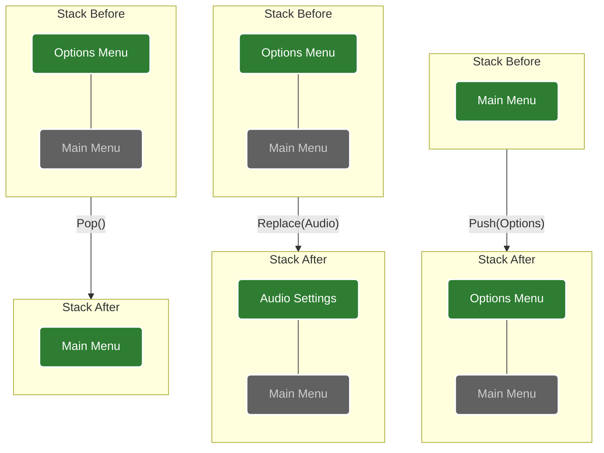
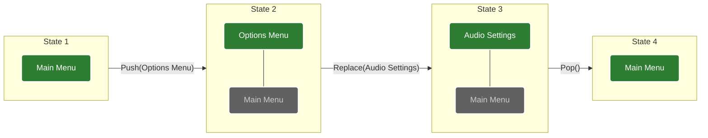

# Terminal

## RicerScenes library

### The scene stack

RiverScenes works by using a scene stack that the user (that's you) can push, pop or replace scenes from dynamically throughout the course of an application.

The scenestack is the "puppetmaster" or manager of the scenes in the application and is responsible for making sure that the scenes transition from one another correctly.

### Scene repository pattern

Whilst scenes can be pushed dynamically onto the stack using the `new()` keyword, it is recommended (if your application allows) to instead createa a statically initialized stack of your scenes. This prevents mistakes like memory leaks by recursive object instancing. It also provides a neat API for yourself when using the `Push`, `Pop`, `Replace` methods.

### `Push`, `Pop`, `Replace`

When a scene has finished running, it **has to** return a scenetransition that the SceneManager can interpretate. These transitions are:

- `SceneTransition.Pop()`
  Exit the current scene and let the last scene take control again. This is good for sub-menus or wizards that just need to do something and then return the user to wherever they came from.

- `SceneTransition.Push(IScene nextScene)`
  Exit the current scene and move onto the next scene wihtout removing the current scene from the stack. This means that if the nextScene uses `SceneTransition.Pop()`, the current scene is the scene that will load back in.

- `SceneTransition.Replace(IScene nextScene)`
  Exit the current scene and remove it from the scene stack. The next scene will replace the current scene in the stack, meaning if the next scene uses `SceneTransition.Pop()`, we move back an "_extra scene_".

#### Visualized

- **Green**: Active scene
- **Gray**: Resting / inactive scene



**What it looks like in practice**



### The `IScene` interface

The `IScene` interface is what makes this all possible, this is the contract between the scene objects you make, and the scene stack.

To create a scene out of the interface, just apply it as usual:

```csharp
class SMain : IScene
{
	public void Enter()
	{
	}

	public void Exit()
	{
	}

	public SceneTransition Run()
	{
	}
}
```

_Note: When you implement the interface, you must also add the `Enter`, `Exit` and `Run` methods, which leads us to..._

#### Required methods

##### `public void Enter`

This method will run **every time** the scene becomes active. It can be used to subscribe to events, reset data that may be contaminated or fetching necessary objects.

A good example of when the `Enter()` method proves useful is the _deferred transition pattern_, where we set `_deferredTransition` to `null` each time we enter the scene, ensuring a default state.

##### `public void Exit`

This method will **every time** the scene becomes inactive. Meaning when the `Run()` has returned a `Push`, `Pop` or `Replace`. This is useful for clearing event subscribers, killing connections or just sanitizing data after usage.

##### `public SceneTransition Run`

This is the method that acutally manages your core scene logic! In here you can do all your `Console.WriteLine()`, `Console.ReadLine()`, data fetches, business layer logic and whatnot.  
Anything you'd do in a regular C# application is done in the Run method!

This method is **required** to return a transition.  
The best method for this is, as said above to use a `SceneRepository` with pre-initialized scene objects.

#### Does this mean every single new display needs a new IScene object?

Yes. That is both a blessing and a curse. It allows for super separated code with the drawback of added boilerplate. `CTRL + C` -> `CTRL + V` is your best friend when creating new scenes.

### How do I pass data accross scenes

This is the Achilles heel of RiverScenes - there is no native in-library way to do so, and no de facto best practices recommended by the author (me).

A fast but somewhat limited and fragile way is to use separate static classes to hold the data during transitions. This is not necessarily good practice, but is acceptable in school and private environments.

### The menu system

RiverScenes comes with an automated system for rendering and routing input from menus. This system is great for quick actions that just need to be bound to a key. A scene can have one, or many menus, as menus themselves are just instantiated objects.

#### Creating a menu

The menu system consists of the `Menu` class and the `MenuAction` stuct, you will however only inteact with the _Menu_ itself.

To create a menu, assign a list of MenuActions directly in the constructor.  
Each menu action must contain:

- A console key to read
- A label
- An action with void return

```csharp
Menu _helloMenu = new([
	new(ConsoleKey.H, "Say hello!", () => { Console.WriteLine("Hello world!"); }
]);
```

#### Printing the menu options

To print the options (rows) of the menu, we access the `MenuRows` property.  
This property will automatically return our menu options in a human readable format, separated by new lines.

```csharp
Console.WriteLine(_helloMenu.MenuRows);
```

_Output_

```
H: Say hello!
```

#### Polling the input

`GetAction(ConsoleKey k)` is the method on the Menu that checks if a `ConsoleKey` is mapped to an action. If an action is mapped, this method will automatically return the entire `MenuAction` object or `null`.

Here we are also using `Console.Readkey().key` as an argument, meaning the application will automatically freeze and wait for an input. The input will then be read by the `GetAction` method resulting in an `MenuAction?` bneing passed into the resultAction variable.

_NOTE: intercept: true just ensures that we do not print the letter 'H' to the console when we press it._

```csharp
var resultAction = _helloMenu.GetAction(Console.ReadKey(intercept: true).Key);
```

#### Use the action

If the resultAction is null, we know that the key pressed was not present in the Menu action map. If not, we access the action and run it.

```csharp
	if (resultAction is null)
		Console.WriteLine("Not a valid choice!");
	else
		resultAction?.Action();
```

_NOTE: The GetAction returns the MenuAction object, meaning we are holding the object we defined in the Menu constructor._
_This is why we need to run .Action(). The object we are holding in this example looks like this:_

```
	Key: ConsoleKey.H,
	Label: "Say hello!",
	Action: () => { Console.WriteLine("Hello world!"); }
```

#### The full script

```csharp
using System;
using RiverScenes;

class STestScene : IScene
{
	Menu _helloMenu = new([
		new(ConsoleKey.H, "Say hello!", () => { Console.WriteLine("Hello world!"); })
	]);

	public void Enter() { }

	public void Exit() { }

	public SceneTransition Run()
	{
		Console.WriteLine(_helloMenu.MenuRows);

		var resultAction = _helloMenu.GetAction(Console.ReadKey(intercept: true).Key);

		if (resultAction is null)
			Console.WriteLine("Not a valid choice!");
		else
			resultAction?.Action();

		// Run must return a transition. Here we just infinitely pass ourselves.
		return new SceneTransition.Replace(this);
	}
}
```

### How to initialize the scenemanager

Just create it and run `Initialize(IScene firstScene)`.

Example:

```csharp
static class SceneRepository
{
	public static STestScene TestScene = new();
}
```

```csharp
using System;
using RiverScenes;

class Program
{
	static void Main(string[] _)
	{
		Console.Clear();
		SceneManager sm = new();

		sm.Initialize(SceneRepository.TestScene);

		Console.WriteLine("End of main execution (success).");
	}
}
```
